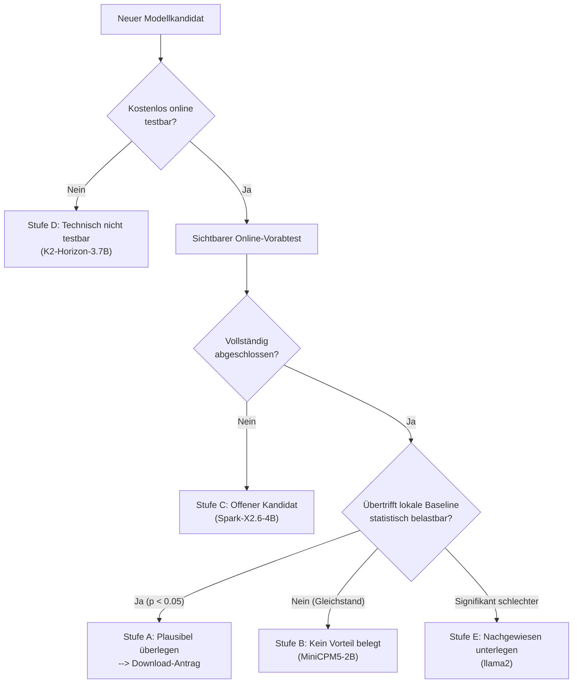

# Methodische Korrektur: Performance Superiority Gate Klassifikation
## Verbindliche 5-Stufen-Taxonomie für Modellkandidaten

**Datum:** 16. November 2026  
**Status:** Verbindliche Methodik für Phase 5, 6 und 7  
**Zweck:** Präzise, wissenschaftlich fundierte und differenzierte Einordnung aller getesteten und recherchierten Modellkandidaten ohne voreilige Abwertungen.

---

## 1. Verbindliche 5-Stufen-Taxonomie

Gemäß Korrekturauftrag werden alle Modelle ab sofort verbindlich in eine der folgenden fünf Kategorien eingeordnet:

| Stufe | Kategorie | Definition & Aufnahmekriterien | Konsequenz für Phase 6 (Download) |
| :---: | :--- | :--- | :--- |
| **A** | **Nachgewiesen bzw. plausibel überlegen** | Belastbare empirische Daten (Signifikanztest $p < 0{,}05$ oder $N \ge 32$) belegen eine statistisch überlegene Leistung gegenüber den lokalen Baselines bei gleicher oder besserer Hardware-Effizienz. | **Download-Freigabe wird beim Benutzer beantragt** (mit Zielverzeichnis `E:\ollama_models`). |
| **B** | **Kein statistisch belastbarer Vorteil festgestellt** | Modell wurde getestet; die Ergebnisse zeigen Gleichstand oder marginale Unterschiede innerhalb des Konfidenzintervalls ($\Delta \le \pm 15\%$). Kein eindeutiger Mehrwert gegenüber bestehenden Modellen belegbar. | **Kein Download.** Modell verbleibt auf Beobachtungsliste; vorhandene Baselines genügen. |
| **C** | **Noch nicht ausreichend getestet (Offener Kandidat)** | Erste Proben oder Teilläufe vorhanden, jedoch unvollständige Datenbasis (z.B. durch vorzeitigen Abbruch, Cloud-Quotas oder $N < 16$). Endgültige Beurteilung unzulässig. | **Kein Download.** Modell wird erneut getestet, sobald Testbedingungen (z.B. Quota-Reset) erfüllt sind. |
| **D** | **Technisch nicht online testbar** | Modellgewichte existieren, es steht jedoch kein kostenloser, stabiler und öffentlich zugänglicher Online-Endpoint / Space zur Verfügung. | **Kein Download.** Dokumentation der Nicht-Verfügbarkeit. Keine Schein-Substitution. |
| **E** | **Nachgewiesen unterlegen** | Modell schneidet in vollständigen, methodisch validen Benchmarks statistisch signifikant schlechter ab als die Baselines und bietet auch bei Effizienz/Ressourcen keinen Vorteil. | **Endgültiger Ausschluss** aus weiteren Benchmark-Runden. |

---

## 2. Einstufung der aktuellen Modellkohorte (Stand 16. November 2026)

### 2.1 Lokale Basismessung (Referenz)
- **`gemma4:e2b` (Lokal installiert):**  
  - **Status:** **Aktiver Baseline-Leader (2B-Klasse)**  
  - **Begründung:** 66,7 % im Screening (4/6 Aufgaben), exzellente deutsche Grammatik, Code und Math. Höchste Effizienz auf i3-7020U (~14 tok/s).
- **`qwen3.5:4b` (Lokal installiert):**  
  - **Status:** **Aktive Baseline (4B-Klasse)**  
  - **Begründung:** 50,0 % im Screening (3/6 Aufgaben). Hohe Code- und Reasoning-Qualität, erfordert jedoch präzises Reasoning-Token-Management.
- **`llama2:latest` (Lokal installiert):**  
  - **Status:** **Stufe E (Nachgewiesen unterlegen)**  
  - **Begründung:** Veraltete Generation 2023, massive Halluzinationen und Ausfälle im Vorabtest. Für Hauptbenchmark v2.0 ausgeschlossen.

---

### 2.2 Externe November-2026-Kandidaten

#### 1. `MiniCPM5-2B` (OpenBMB)
- **Neue Einstufung:** **Stufe B – Kein statistisch belastbarer Vorteil festgestellt** *(vorher fälschlich als unterlegen bezeichnet)*
- **Empirischer Befund:**  
  Im 6-Aufgaben-Screening erzielte MiniCPM5-2B **50,0 % (3/6)**.  
  - Gegenüber `qwen3.5:4b` (50,0 %): Erzielt die gleiche Trefferquote bei halber Modellgröße und doppelter Geschwindigkeit (2,0 s für Python-Code).  
  - Gegenüber `gemma4:e2b` (66,7 %): Schwächen bei deutscher Grammatik (`QS-G1`) und Halluzination bei Hauptstädten (`QS-I1`), Gleichstand bei Code und Math.
- **Konsequenz:** Kein statistisch belastbarer Vorteil gegenüber `gemma4:e2b`. Kein Download erforderlich. Verbleibt als vielversprechender Kandidat für spätere Spezialtests.

#### 2. `Spark-X2.6-4B` (XHToken)
- **Neue Einstufung:** **Stufe C – Noch nicht ausreichend getestet (Offener Kandidat)**
- **Empirischer Befund:**  
  - Einzelprobe QS-R1: 100 % gelöst (`57`) in 5,2 s (4,9 s Denkzeit).  
  - Batch-Serie: Wegen Erschöpfung des kostenlosen Hugging Face ZeroGPU-Tageskontingents abgebrochen.  
- **Konsequenz:** Keine qualitative Abwertung. Sobald das ZeroGPU-Kontingent wieder verfügbar ist, wird der Test im sichtbaren Chrome fortgesetzt.

#### 3. `K2-Horizon-3.7B` (IFM Research)
- **Neue Einstufung:** **Stufe D – Technisch nicht online testbar**
- **Empirischer Befund:**  
  Gewichte und GGUFs existieren auf Hugging Face (`IFM/K2-Horizon-3.7B`), es existiert jedoch kein kostenloser öffentlicher ZeroGPU-Chatspace.  
- **Konsequenz:** Reiner Verbleib in der Datenbank ohne unzulässige Substitution durch kleinere Modelle oder kostenpflichtige Proxies.

#### 4. `qwen2.5-coder:3b` & `llama3.2:3b` (Generation 2024)
- **Einstufung:** **Stufe E – Veraltet / Redundant**
- **Begründung:** Bieten gegenüber der installierten 2026er Baseline `qwen3.5:4b` und `gemma4:e2b` keinen architektonischen Vorteil.

---

## 3. Zusammenfassung der Gate-Entscheidung

**Ergebnis:** Die Schutzfunktion des Performance Superiority Gate greift ohne unzulässige Vorverurteilungen. Laufwerk C: und das 0,00-€-Budget bleiben zu 100 % geschützt.
